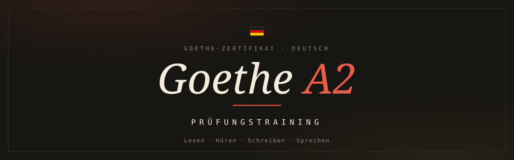

<p align="center">
  
</p>

<p align="center">
  <b>Free, offline-first exam trainer for the Goethe-Zertifikat A2</b><br>
  Lesen · Hören · Schreiben · Sprechen — all four modules, exam-authentic flow.
</p>

<p align="center">
  <a href="#english">🇬🇧 English</a> · <a href="#russian">🇷🇺 Русский</a>
</p>

<p align="center">
  
  
  
  
</p>

---

<a name="english"></a>

## 🇬🇧 English

A complete, self-contained web app to prepare for the **Goethe-Zertifikat A2** exam. It covers all four exam modules plus a strategy/grammar reference. Every text, transcript, prompt and topic is **AI-generated** from the format of textbook exercises and official Goethe practice tasks; the project contains no copyrighted material. It runs in any modern browser with **no server, no build step and no installation**. Exam logic, progress and Hören audio work offline; fonts load from Google Fonts when a network is available.

### What's inside

| Module | Content | Volume |
|---|---|---|
| **Lesen** (Reading) | Teil 1–4: newspaper articles, information boards, personal e-mails, ad-matching. Multiple choice in the exam format. | **100 full tests** (Teil 1–4, 20 questions each) |
| **Hören** (Listening) | Teil 1–4: announcements, picture-matching, everyday dialogues, a Ja/Nein interview. Real text-to-speech audio (edge-tts voices). | **100 full tests** (20 tasks, 12 audio clips each) |
| **Schreiben** (Writing) | Teil 1 (SMS to a friend) + Teil 2 (semi-formal e-mail). On-page AI grading by the official Goethe criteria, or a manual/copy-prompt mode. | **100 full tests** (Teil 1 + 2) |
| **Sprechen** (Speaking) | Teil 1 question cards, Teil 2 monologue topics, Teil 3 a "find an appointment" planning task, all with countdown timers. | **100 full tests** (Teil 1–3) |
| **Hilfen** (Help) | Per-Teil exam strategies, grammar quick-reference and Redemittel. Trilingual (DE / EN / RU). Each module deep-links straight to the relevant strategy. | — |

### Features

- **Exam-authentic** flow, instructions and timing for every Teil.
- **Progress tracking** — completion is saved per task to `localStorage`; each module shows `N / Total erledigt` and the home page aggregates everything.
- **Real listening audio** generated locally with [edge-tts](https://github.com/rany2/edge-tts) (multiple adult "Sie"-register voices).
- **AI writing feedback** — bring your own API key (Anthropic or any OpenAI-compatible endpoint such as OpenRouter). The model returns a score by the two Goethe criteria, per-Leitpunkt checks, an error list, a corrected version and feedback.
- **Offline-capable** — logic, progress and Hören audio work without a network. The only feature that needs the internet is the optional AI writing check. Fonts come from Google Fonts and fall back to system fonts if the CDN is unreachable.
- **Zero dependencies, zero build** — plain HTML, CSS and vanilla JavaScript.
- **Cohesive design system** — a warm dark theme with *Fraunces*, *Bricolage Grotesque* and *JetBrains Mono*.

### Two ways to use it

1. **Online** — open the deployed site (e.g. on Vercel). Nothing to download; progress is saved in that browser.
2. **Offline** — download the repository (*Code → Download ZIP*) or `git clone`, then open `index.html`. Tasks, answers and Hören audio work without a connection. Fonts may fall back to system defaults if Google Fonts is unreachable.

> Progress is stored **per browser / per device** via `localStorage`; it is not synced across devices and is cleared if you clear the site's data.

### Project structure

```
.
├── index.html              # Dashboard / module launcher
├── lesen.html              # Reading
├── hoeren.html             # Listening
├── schreiben.html          # Writing (+ AI evaluation)
├── sprechen.html           # Speaking
├── hilfen.html             # Strategies + grammar (DE/EN/RU)
├── vercel.json             # Static cache headers
├── assets/
│   ├── base.css            # Shared theme tokens & shell
│   ├── progress.js         # Progress tracker + shared helpers
│   ├── banner.svg          # README banner
│   ├── data/*.js           # Test content (Lesen / Hören / Schreiben / Sprechen)
 │   ├── audio/              # Listening audio (edge-tts, ~325 MB)
 │   └── images/             # Hören picture-matching images (~171 MB)
└── tools/                  # Content generation & validation (Python)
```

### Tools (`tools/`)

Maintained helpers for regenerating content (require Python 3):

- `generate_audio.py` — synthesise the Hören audio with edge-tts.
- `generate_images.py` / `generate_images_cf.py` — generate the picture-matching images.
- `_compile_tests.py` — compile the listening JSON into the site data.
- `_split_data.py` — split the data into lazy per-test / per-Teil chunks (file://-friendly, no fetch).
- `_validate_tests.py` — structural + answer-key validation of all tests.

### Privacy

No backend, no analytics, no tracking. Your progress and your API key live only in your browser's `localStorage`. The API key is sent **only** to the provider you configure, directly from your browser.

### Content & trademarks

All content is AI-generated for practice and contains no copyrighted exam material. *Goethe-Zertifikat* is a trademark of the **Goethe-Institut e.V.** This is an independent, unofficial study tool and is **not affiliated with or endorsed by the Goethe-Institut**.

### License

Released under the [MIT License](LICENSE).

---

<a name="russian"></a>

## 🇷🇺 Русский

Полноценное автономное веб-приложение для подготовки к экзамену **Goethe-Zertifikat A2**. Охватывает все четыре модуля экзамена плюс справочник стратегий и грамматики. Все тексты, аудио-сценарии, задания и темы **сгенерированы ИИ** по формату заданий из учебников и официальных тренировочных материалов Goethe; защищённых авторским правом материалов в проекте нет. Работает в любом современном браузере **без сервера, без сборки и без установки**. Логика экзамена, прогресс и аудио Hören работают офлайн; шрифты грузятся с Google Fonts, когда есть сеть.

### Что внутри

| Модуль | Содержание | Объём |
|---|---|---|
| **Lesen** (чтение) | Teil 1–4: газетные статьи, информационные табло, личные e-mail, сопоставление объявлений. Множественный выбор в формате экзамена. | **100 полных тестов** (Teil 1–4, по 20 вопросов) |
| **Hören** (аудирование) | Teil 1–4: объявления, сопоставление с картинками, бытовые диалоги, интервью «Ja/Nein». Настоящее озвучивание (голоса edge-tts). | **100 полных тестов** (по 20 заданий, по 12 аудио) |
| **Schreiben** (письмо) | Teil 1 (SMS другу) + Teil 2 (полуофициальный e-mail). Проверка ИИ по официальным критериям Goethe прямо на странице или ручной режим. | **100 полных тестов** (Teil 1 + 2) |
| **Sprechen** (говорение) | Teil 1 — карточки с вопросами, Teil 2 — темы для монолога, Teil 3 — планирование встречи, всё с таймерами обратного отсчёта. | **100 полных тестов** (Teil 1–3) |
| **Hilfen** (помощь) | Стратегии по каждому Teil, краткий справочник грамматики и Redemittel. На трёх языках (DE / EN / RU). Каждый модуль ведёт прямой ссылкой к нужной стратегии. | — |

### Возможности

- **Аутентичный формат**: ход, инструкции и тайминг как на реальном экзамене, для каждого Teil.
- **Учёт прогресса** — выполнение сохраняется по каждому заданию в `localStorage`; каждый модуль показывает `N / Total erledigt`, а главная страница агрегирует всё.
- **Настоящее аудио** генерируется локально через [edge-tts](https://github.com/rany2/edge-tts) (несколько «взрослых» голосов в регистре «Sie»).
- **Проверка письма ИИ** — со своим API-ключом (Anthropic или любой OpenAI-совместимый эндпоинт, например OpenRouter). Модель возвращает оценку по двум критериям Goethe, проверку по каждому Leitpunkt, список ошибок, исправленную версию и обратную связь.
- **Офлайн** — логика, прогресс и аудио Hören работают без сети. Интернет нужен только опциональной проверке письма. Шрифты грузятся с Google Fonts и при недоступном CDN откатываются на системные.
- **Ноль зависимостей, ноль сборки** — чистые HTML, CSS и ванильный JavaScript.
- **Единый дизайн** — тёплая тёмная тема со шрифтами *Fraunces*, *Bricolage Grotesque* и *JetBrains Mono*.

### Два способа использования

1. **Онлайн** — открыть развёрнутый сайт (например, на Vercel). Ничего качать не нужно; прогресс сохраняется в этом браузере.
2. **Офлайн** — скачать репозиторий (*Code → Download ZIP*) или `git clone` и открыть `index.html`. Задания, ответы и аудио Hören работают без сети. Шрифты могут откатиться на системные, если Google Fonts недоступен.

> Прогресс хранится **в каждом браузере / на каждом устройстве** через `localStorage`; он не синхронизируется между устройствами и стирается при очистке данных сайта.

### Структура проекта

```
.
├── index.html              # Дашборд / запуск модулей
├── lesen.html              # Чтение
├── hoeren.html             # Аудирование
├── schreiben.html          # Письмо (+ проверка ИИ)
├── sprechen.html           # Говорение
├── hilfen.html             # Стратегии + грамматика (DE/EN/RU)
├── vercel.json             # Заголовки кэша для статики
├── assets/
│   ├── base.css            # Общие токены темы и «оболочка»
│   ├── progress.js         # Трекер прогресса + общие хелперы
│   ├── banner.svg          # Баннер README
│   ├── data/*.js           # Контент тестов (Lesen / Hören / Schreiben / Sprechen)
 │   ├── audio/              # Аудио для Hören (edge-tts, ~325 МБ)
 │   └── images/             # Картинки для сопоставления в Hören (~171 МБ)
└── tools/                  # Генерация и валидация контента (Python)
```

### Инструменты (`tools/`)

Поддерживаемые скрипты для перегенерации контента (нужен Python 3):

- `generate_audio.py` — синтез аудио Hören через edge-tts.
- `generate_images.py` / `generate_images_cf.py` — генерация картинок для сопоставления.
- `_compile_tests.py` — компиляция JSON аудирования в данные сайта.
- `_split_data.py` — нарезка данных на ленивые чанки по тестам/Teilen (дружелюбно к file://, без fetch).
- `_validate_tests.py` — структурная проверка и проверка ключей ответов всех тестов.

### Приватность

Нет бэкенда, аналитики и трекинга. Твой прогресс и API-ключ хранятся только в `localStorage` твоего браузера. Ключ отправляется **только** выбранному тобой провайдеру, напрямую из браузера.

### Контент и товарные знаки

Весь контент сгенерирован ИИ для тренировки и не содержит защищённых авторским правом экзаменационных материалов. *Goethe-Zertifikat* — товарный знак **Goethe-Institut e.V.** Это независимый, неофициальный учебный инструмент, **не связанный с Goethe-Institut и не одобренный им**.

### Лицензия

Распространяется по лицензии [MIT](LICENSE).
